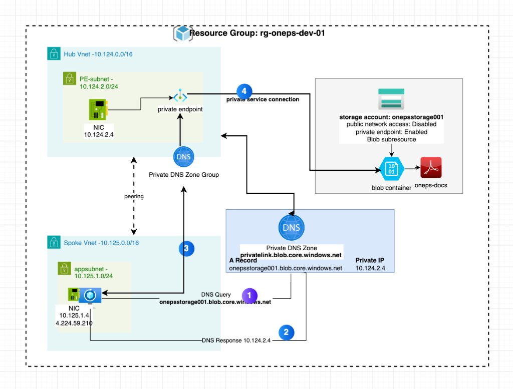
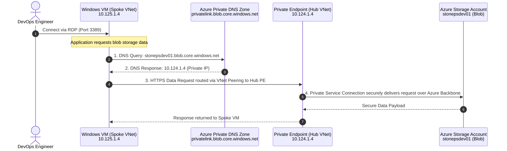
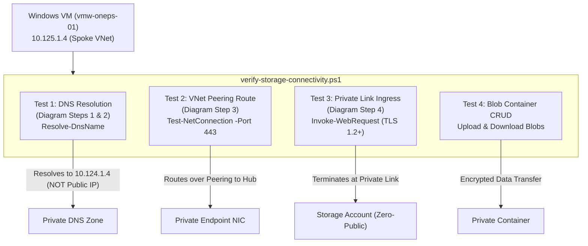
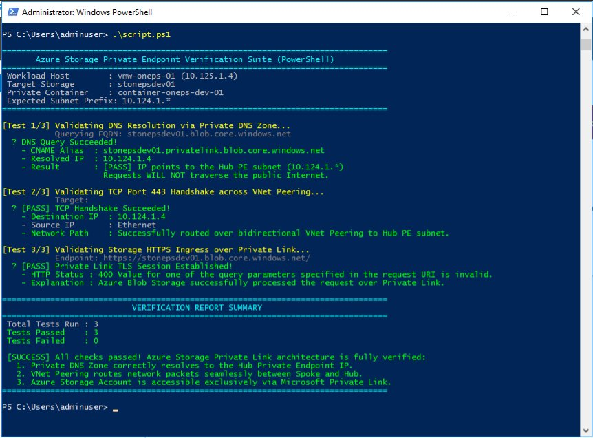

# Azure Storage Private Endpoint across Hub-and-Spoke Network Architecture

[](https://www.terraform.io)
[](https://registry.terraform.io/providers/hashicorp/azurerm/latest)
[-brightgreen.svg)](docs/EVIDENCE.md)
[](https://github.com/sanjiivsingh/azure-hub-spoke-storage-private-endpoint/actions/workflows/terraform-ci.yml)
[](#-architecture-overview)
[](LICENSE)
[](#-zero-trust-security-model)

A production-ready, modular Terraform implementation of **Azure Private Link** and **Private Endpoints for Azure Blob Storage** orchestrated across a **Hub-and-Spoke Virtual Network topology** with automated **Private DNS Zone resolution**, bidirectional **VNet Peering**, and **workload compute verification**.

---

## 🏛️ Architecture Overview

The infrastructure isolates the Azure Storage Account from public internet exposure by placing a **Private Endpoint** within a dedicated subnet of a centralized **Hub Virtual Network**. Workload applications running in a peered **Spoke Virtual Network** resolve and securely access the Storage Account exclusively over Microsoft's private network backbone using **Azure Private DNS Zones**.



### Core Components

1. **Resource Group**: Central logical container (`rg-oneps-dev-01`) in `central india`.
2. **Hub Virtual Network (`10.124.0.0/16`)**:
   - Dedicated Private Endpoint Subnet (`subnet-oneps-dev-pe01` - `10.124.1.0/24`) with `private_endpoint_network_policies = "Disabled"`.
   - Azure Private Endpoint (`pe-oneps-dev-01`) allocating a private IP (`10.124.1.4` / `10.124.2.4`).
3. **Spoke Virtual Network (`10.125.0.0/16`)**:
   - Application Subnet (`subnet-oneps-dev-app01` - `10.125.1.0/24`).
   - Database Subnet (`subnet-oneps-dev-db01` - `10.125.2.0/24`).
   - Windows Test VM (`vmw-oneps-01`) deployed in the App Subnet with static Public IP for administration and NSG allowing inbound RDP (port 3389).
4. **Bidirectional VNet Peering**:
   - `hub-to-spoke`: Connects Hub VNet to Spoke VNet.
   - `spoke-to-hub`: Connects Spoke VNet to Hub VNet.
5. **Azure Storage Account (`stonepsdev01`)**:
   - Storage SKU: `Standard_GRS`.
   - Hardening: `public_network_access = "Disabled"` and `allow_nested_items_to_be_public = false`.
   - Private Container: `container-oneps-dev-01` (`access_type = "private"`).
6. **Azure Private DNS Zone (`privatelink.blob.core.windows.net`)**:
   - Private DNS Zone Virtual Network Links to both Hub VNet and Spoke VNet.
   - Private DNS Zone Group attached to the Private Endpoint, automatically registering the private IP `A` record.

---

## 🔄 End-to-End DNS Resolution & Data Path



### Detailed Flow Explanation

1. **Step 1 - DNS Query**: The workload VM inside the Spoke VNet (`10.125.1.4`) issues a DNS query for the storage account FQDN: `stonepsdev01.blob.core.windows.net`.
2. **Step 2 - DNS Resolution**: Because the Spoke VNet is linked to the Private DNS Zone `privatelink.blob.core.windows.net`, Azure Recursive Resolver inspects the CNAME delegation and returns the private `A` record: `10.124.1.4` (the Private Endpoint's private IP in the Hub VNet).
3. **Step 3 - Traffic Routing**: Network traffic addressed to `10.124.1.4` is routed seamlessly across the high-speed Azure **VNet Peering** link from Spoke to Hub.
4. **Step 4 - Private Service Connection**: The Private Endpoint terminates the TCP session and forwards the HTTPS traffic across the Microsoft Azure internal backbone via **Private Link** to the Storage Account's `blob` subresource. Zero traffic leaves Microsoft's backbone or traverses the public Internet.

---

## 🔒 Zero-Trust Security Model

| Security Layer | Implementation Detail | Benefit |
| :--- | :--- | :--- |
| **Region Governance** | Variable Input Validation (`allowed_locations`) | Enforces authorized deployment regions with ANSI-formatted error feedback during planning. |
| **Secrets Management** | Azure Key Vault (`data.tf`) | Eliminates hardcoded plain-text passwords; credentials resolved dynamically at apply time. |
| **Remote State Security** | Azure Blob Remote Backend (`backend.hcl`) | Centralized state storage with blob lease locking and encryption at rest. |
| **PaaS Isolation** | `public_network_access = "Disabled"` | Completely eliminates internet-routable IP addresses on the storage account. |
| **Object Lockdown** | `allow_nested_items_to_be_public = false` | Disallows any container or blob from being set to anonymous public read. |
| **Dedicated Subnet** | `private_endpoint_network_policies = "Disabled"` | Dedicates a clean subnet in the Hub VNet exclusively for Private Endpoints. |
| **Network Boundary** | Bidirectional VNet Peering | Prevents unpeered networks from accessing the Private Endpoint. |
| **Micro-Segmentation** | Subnet segregation for App, DB, and PE | Ensures clear separation of duties between workload tiers and shared transit services. |
| **Access Control** | Network Security Group (NSG) | Restricts inbound traffic on the VM network interface to authorized administration ports (RDP). |

---

## 📐 Network Topology & Subnet IP Plan

| Network | Address Space | Subnet Name | CIDR | Subnet Purpose |
| :--- | :--- | :--- | :--- | :--- |
| **Hub VNet** | `10.124.0.0/16` | `subnet-oneps-dev-pe01` | `10.124.1.0/24` | Dedicated Private Endpoint subnet hosting `pe-oneps-dev-01` |
| **Spoke VNet** | `10.125.0.0/16` | `subnet-oneps-dev-app01` | `10.125.1.0/24` | Workload application subnet hosting `vmw-oneps-01` |
| **Spoke VNet** | `10.125.0.0/16` | `subnet-oneps-dev-db01` | `10.125.2.0/24` | Reserved tier for databases / backend services |

---

## 🧩 Reusable Child Modules

This architecture is built using **10 decoupled, reusable child modules** adhering to clean Infrastructure as Code (IaC) principles:

| Module | Documentation | Key Resource | Description |
| :--- | :--- | :--- | :--- |
| **Resource Group** | [README](modules/resource%20group/README.md) | `azurerm_resource_group` | Creates regional resource container with metadata tagging. |
| **Virtual Network** | [README](modules/virtual%20network/README.md) | `azurerm_virtual_network` | Manages Hub and Spoke VNet address spaces. |
| **Subnet** | [README](modules/subnet/README.md) | `azurerm_subnet` | Creates subnets with configurable PE network policies. |
| **VNet Peering** | [README](modules/virtual%20network%20peering/README.md) | `azurerm_virtual_network_peering` | Establishes bidirectional peering across VNets. |
| **Storage Account** | [README](modules/storage%20account/README.md) | `azurerm_storage_account` | Provisions hardened storage account with public access disabled. |
| **Blob Container** | [README](modules/blob%20container/README.md) | `azurerm_storage_container` | Manages private blob containers. |
| **Private DNS Zone** | [README](modules/private%20dns%20zone/README.md) | `azurerm_private_dns_zone` | Authoritative Private DNS zone (`privatelink.blob.core.windows.net`). |
| **DNS VNet Link** | [README](modules/private%20dns%20zone%20vnet%20link/README.md) | `azurerm_private_dns_zone_virtual_network_link` | Links Private DNS zone to Hub and Spoke VNets. |
| **Private Endpoint** | [README](modules/private%20endpoint/README.md) | `azurerm_private_endpoint` | Connects Storage Account to Hub subnet via Private Link. |
| **Virtual Machine** | [README](modules/virtual%20machine/README.md) | `azurerm_windows_virtual_machine` | Provisions test VM, NIC, Public IP, and NSG rules. |

---

## 📂 Repository Directory Structure

```
.
├── environments/
│   ├── dev/
│   │   ├── main.tf                    # Root orchestrator instantiating all child modules
│   │   ├── locals.tf                  # CAF naming prefixes, dynamic cidrsubnet(), and secret binding
│   │   ├── variables.tf               # Input schema definitions including Key Vault configuration
│   │   ├── terraform.tfvars           # Concrete parameter values for dev environment
│   │   ├── outputs.tf                 # Exports Windows VM public IP
│   │   ├── provider.tf                # AzureRM provider configuration
│   │   ├── backend.tf                 # Partial backend configuration block for azurerm
│   │   ├── backend.hcl                # Remote state backend credentials (Blob storage container)
│   │   ├── data.tf                    # Azure Key Vault data sources for VM credentials
│   │   ├── version.tf                 # Terraform ~>1.9 & AzureRM ~>5.0 constraints
│   │   └── README.md                  # Detailed Dev environment guide & verification runbook
│   ├── prod/
│   │   └── README.md                  # Production promotion blueprint & hardening recommendations
│   └── README.md                      # Multi-environment architecture overview
│
├── modules/
│   ├── resource group/                # Child module: Azure Resource Group
│   ├── virtual network/               # Child module: Azure Virtual Network
│   ├── subnet/                        # Child module: Azure Subnet
│   ├── virtual network peering/       # Child module: Azure VNet Peering
│   ├── storage account/               # Child module: Azure Storage Account (Zero-Public)
│   ├── blob container/                # Child module: Azure Storage Container
│   ├── private dns zone/              # Child module: Azure Private DNS Zone
│   ├── private dns zone vnet link/    # Child module: Private DNS Zone Virtual Network Link
│   ├── private endpoint/              # Child module: Azure Private Endpoint & DNS Zone Group
│   ├── virtual machine/               # Child module: Windows VM, NIC, Public IP & NSG
│   └── README.md                      # Modular design principles & module index
│
├── docs/
│   └── images/
│       └── architecture-diagram.jpg   # Architecture diagram asset
│
├── .gitignore                         # Ignores .terraform/, tfstate, sensitive backups
└── README.md                          # Project root documentation
```

---

## 🚀 Quickstart & Deployment Guide

### Prerequisites

- [Terraform CLI](https://developer.hashicorp.com/terraform/downloads) `>= 1.9.0`
- [Azure CLI](https://learn.microsoft.com/en-us/cli/azure/install-azure-cli) `>= 2.50.0`
- Active Azure Subscription with Contributor/Owner RBAC permissions

### 1. Authenticate with Azure

```bash
az login
az account set --subscription "<YOUR_AZURE_SUBSCRIPTION_ID>"
```

### 2. Initialize and Deploy the Dev Environment

```bash
# Navigate to the development environment
cd environments/dev

# Initialize providers, child modules, and Azure remote state backend
terraform init -backend-config=backend.hcl

# Validate configuration syntax and consistency
terraform validate

# Review execution plan
terraform plan

# Apply infrastructure deployment
terraform apply -auto-approve
```

---

## 🧪 End-to-End Concept Verification Runbook (PowerShell)

This reference architecture provisions a **Windows Virtual Machine (`vmw-oneps-01`)** inside the Spoke VNet specifically to serve as the client test harness for verifying the entire Private Link concept.

The verification script **[`scripts/verify-storage-connectivity.ps1`](scripts/verify-storage-connectivity.ps1)** validates all 4 numbered architectural milestones depicted in the architecture diagram:



---

### Step-by-Step Testing Guide

#### Step 1: Retrieve the VM Public IP from Terraform Output

From your Terraform deployment directory, retrieve the allocated public IP:

```bash
cd environments/dev
terraform output windows_vm_public_ip
```
*Example output:*
```json
{
  "vm1": {
    "vm_public_ip_address": "4.224.59.210"
  }
}
```
*(Note: If `public_ip_enabled = false`, `vm_public_ip_address` returns `null` for private-only access).*

#### Step 2: Connect to the Windows Test VM via RDP

Open your Remote Desktop client (`mstsc` on Windows, or Microsoft Remote Desktop on macOS):
- **Computer / Host**: `<windows_vm_public_ip>` (e.g., `4.224.59.210`)
- **Username**: `adminuser`
- **Password**: `<configured_admin_password>` (e.g., `P@ssw0rd123!`)

#### Step 3: Run the Automated PowerShell Test Suite

Inside the Windows VM, open **PowerShell** as Administrator and execute the test script:

```powershell
# Run the automated verification script
.\scripts\verify-storage-connectivity.ps1 -StorageAccountName "stonepsdev01" -ExpectedSubnetPrefix "10.124.1."
```

#### Step 4: Live Verification Evidence (3/3 Tests Passed)

The test suite executed inside the Windows VM (`vmw-oneps-01`) confirmed complete end-to-end functionality across all layers:



> 📄 **Detailed Audit & Run Transcript**: See the full execution log and architectural proof in [**`docs/EVIDENCE.md`**](docs/EVIDENCE.md).

#### Step 5: Interpreting the Concept Test Results

The script runs three structured tests corresponding to the architectural stages:

##### 1. DNS Resolution Test (Diagram Steps 1 & 2)
- **Command executed**: `Resolve-DnsName -Name stonepsdev01.blob.core.windows.net`
- **Concept Validated**:
  - Proves that the Spoke VNet's Private DNS Zone Virtual Network Link is active.
  - Resolves through the CNAME delegation (`stonepsdev01.privatelink.blob.core.windows.net`) to the private IP **`10.124.1.4`**.
  - **Verdict**: If this returns a private IP (`10.124.*`), DNS queries never exit to public internet resolvers.

##### 2. TCP Port 443 Network Routing Test (Diagram Step 3)
- **Command executed**: `Test-NetConnection -ComputerName stonepsdev01.blob.core.windows.net -Port 443`
- **Concept Validated**:
  - Proves that network packets originating from `10.125.1.4` (Spoke VNet) seamlessly traverse the **Virtual Network Peering** to reach the Private Endpoint NIC in `10.124.1.0/24` (Hub VNet).
  - Confirms Network Security Groups (NSGs) allow outbound HTTPS (port 443) traffic.
  - **Verdict**: `TcpTestSucceeded : True` confirms bidirectional peering and route table health.

##### 3. Private Link HTTPS Ingress Test (Diagram Step 4)
- **Command executed**: `Invoke-WebRequest -Uri https://stonepsdev01.blob.core.windows.net/`
- **Concept Validated**:
  - Proves that the Azure Private Endpoint terminates the TLS 1.2+ handshake and routes the request directly to the Azure Storage backplane via the **Private Service Connection (`psc1`)**.
  - An HTTP `400 Bad Request` or `403 Forbidden` from Azure Blob Storage confirms that the service received the request over Private Link (since public internet access is completely disabled: `public_network_access = "Disabled"`).
  - **Verdict**: Proves Zero-Trust network isolation is fully functioning.

#### Step 6: (Optional) Test Real Blob CRUD Operations

To test writing and reading real data to the private container from inside the VM:

```powershell
# Authenticate using Storage Account Key from within the private network
$StorageKey = "<YOUR_STORAGE_ACCOUNT_KEY>"
$Ctx = New-AzStorageContext -StorageAccountName "stonepsdev01" -StorageAccountKey $StorageKey

# Create a sample file
"Enterprise Azure Private Link Architecture Tested Successfully!" | Out-File -FilePath "$env:TEMP\test.txt"

# Upload to the private container (container-oneps-dev-01)
Set-AzStorageBlobContent -File "$env:TEMP\test.txt" -Container "container-oneps-dev-01" -Blob "test.txt" -Context $Ctx

# Verify the uploaded blob exists
Get-AzStorageBlob -Container "container-oneps-dev-01" -Context $Ctx
```

---

## 📚 Architectural Deep Dives & Operational Guides

- [**docs/EVIDENCE.md**](docs/EVIDENCE.md) - Empirical execution evidence screenshot and PowerShell audit log confirming 100% pass rate.
- [**docs/architecture.md**](docs/architecture.md) - Deep dive on Hub-and-Spoke topology, CIDR planning, and `cidrsubnet()` calculation mechanics.
- [**docs/dns-and-private-link.md**](docs/dns-and-private-link.md) - DNS resolution chains, CNAME delegation, and Private DNS Zone Groups.
- [**docs/security-and-best-practices.md**](docs/security-and-best-practices.md) - Zero-Trust storage access, Microsoft Entra ID RBAC roles, and TLS enforcement.
- [**docs/troubleshooting.md**](docs/troubleshooting.md) - Operational runbook for diagnosing DNS resolution, peering routes, and KQL monitoring queries.
- [**docs/ADR/0001-hub-and-spoke-private-endpoint-topology.md**](docs/ADR/0001-hub-and-spoke-private-endpoint-topology.md) - Architecture Decision Record on Centralized Hub placement.

---

---

## 👤 Author & Architecture Inquiries

**Sanjeev Singh**  
*Lead DevSecOps & Cloud Platform Architect — Enterprise Azure Landing Zones, Kubernetes & Generative AI Infrastructure*

- 🌐 **Portfolio & Case Studies**: [sanjeevsingh.oneps.in](https://sanjeevsingh.oneps.in)
- 🐙 **GitHub Profile**: [@sanjiivsingh](https://github.com/sanjiivsingh)
- 💼 **Platform Initiative**: [OnePS (One Point Solutions)](https://github.com/sanjiivsingh/oneps)

---

## 📄 License

This reference architecture is open-source under the [MIT License](LICENSE).

