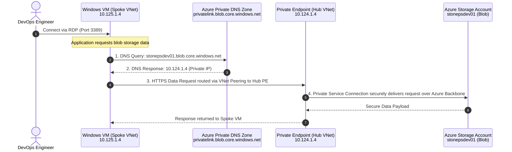

# Azure Storage Private Endpoint across Hub-and-Spoke Network Architecture

[](https://www.terraform.io)
[](https://registry.terraform.io/providers/hashicorp/azurerm/latest)
[](#-architecture-overview)
[](LICENSE)
[](#-zero-trust-security-model)

A production-ready, modular Terraform implementation of **Azure Private Link** and **Private Endpoints for Azure Blob Storage** orchestrated across a **Hub-and-Spoke Virtual Network topology** with automated **Private DNS Zone resolution**, bidirectional **VNet Peering**, and **workload compute verification**.

---

## 🏛️ Architecture Overview

The infrastructure isolates the Azure Storage Account from public internet exposure by placing a **Private Endpoint** within a dedicated subnet of a centralized **Hub Virtual Network**. Workload applications running in a peered **Spoke Virtual Network** resolve and securely access the Storage Account exclusively over Microsoft's private network backbone using **Azure Private DNS Zones**.


### Core Components

1. **Resource Group**: Central logical container (`rg-oneps-dev-01`) in `central india`.
2. **Hub Virtual Network (`10.124.0.0/16`)**:
   - Dedicated Private Endpoint Subnet (`subnet-oneps-dev-pe01` - `10.124.1.0/24`) with `private_endpoint_network_policies = "Disabled"`.
   - Azure Private Endpoint (`pe-oneps-dev-01`) allocating a private IP (`10.124.1.4` / `10.124.2.4`).
3. **Spoke Virtual Network (`10.125.0.0/16`)**:
   - Application Subnet (`subnet-oneps-dev-app01` - `10.125.1.0/24`).
   - Database Subnet (`subnet-oneps-dev-db01` - `10.125.2.0/24`).
   - Windows Test VM (`vmw-oneps-01`) deployed in the App Subnet with static Public IP for administration and NSG allowing inbound RDP (port 3389).
4. **Bidirectional VNet Peering**:
   - `hub-to-spoke`: Connects Hub VNet to Spoke VNet.
   - `spoke-to-hub`: Connects Spoke VNet to Hub VNet.
5. **Azure Storage Account (`stonepsdev01`)**:
   - Storage SKU: `Standard_GRS`.
   - Hardening: `public_network_access = "Disabled"` and `allow_nested_items_to_be_public = false`.
   - Private Container: `container-oneps-dev-01` (`access_type = "private"`).
6. **Azure Private DNS Zone (`privatelink.blob.core.windows.net`)**:
   - Private DNS Zone Virtual Network Links to both Hub VNet and Spoke VNet.
   - Private DNS Zone Group attached to the Private Endpoint, automatically registering the private IP `A` record.

---

## 🔄 End-to-End DNS Resolution & Data Path



### Detailed Flow Explanation

1. **Step 1 - DNS Query**: The workload VM inside the Spoke VNet (`10.125.1.4`) issues a DNS query for the storage account FQDN: `stonepsdev01.blob.core.windows.net`.
2. **Step 2 - DNS Resolution**: Because the Spoke VNet is linked to the Private DNS Zone `privatelink.blob.core.windows.net`, Azure Recursive Resolver inspects the CNAME delegation and returns the private `A` record: `10.124.1.4` (the Private Endpoint's private IP in the Hub VNet).
3. **Step 3 - Traffic Routing**: Network traffic addressed to `10.124.1.4` is routed seamlessly across the high-speed Azure **VNet Peering** link from Spoke to Hub.
4. **Step 4 - Private Service Connection**: The Private Endpoint terminates the TCP session and forwards the HTTPS traffic across the Microsoft Azure internal backbone via **Private Link** to the Storage Account's `blob` subresource. Zero traffic leaves Microsoft's backbone or traverses the public Internet.

---

## 🔒 Zero-Trust Security Model

| Security Layer | Implementation Detail | Benefit |
| :--- | :--- | :--- |
| **PaaS Isolation** | `public_network_access = "Disabled"` | Completely eliminates internet-routable IP addresses on the storage account. |
| **Object Lockdown** | `allow_nested_items_to_be_public = false` | Disallows any container or blob from being set to anonymous public read. |
| **Dedicated Subnet** | `private_endpoint_network_policies = "Disabled"` | Dedicates a clean subnet in the Hub VNet exclusively for Private Endpoints. |
| **Network Boundary** | Bidirectional VNet Peering | Prevents unpeered networks from accessing the Private Endpoint. |
| **Micro-Segmentation** | Subnet segregation for App, DB, and PE | Ensures clear separation of duties between workload tiers and shared transit services. |
| **Access Control** | Network Security Group (NSG) | Restricts inbound traffic on the VM network interface to authorized administration ports (RDP). |

---

## 📐 Network Topology & Subnet IP Plan

| Network | Address Space | Subnet Name | CIDR | Subnet Purpose |
| :--- | :--- | :--- | :--- | :--- |
| **Hub VNet** | `10.124.0.0/16` | `subnet-oneps-dev-pe01` | `10.124.1.0/24` | Dedicated Private Endpoint subnet hosting `pe-oneps-dev-01` |
| **Spoke VNet** | `10.125.0.0/16` | `subnet-oneps-dev-app01` | `10.125.1.0/24` | Workload application subnet hosting `vmw-oneps-01` |
| **Spoke VNet** | `10.125.0.0/16` | `subnet-oneps-dev-db01` | `10.125.2.0/24` | Reserved tier for databases / backend services |

---

## 🧩 Reusable Child Modules

This architecture is built using **10 decoupled, reusable child modules** adhering to clean Infrastructure as Code (IaC) principles:

| Module | Documentation | Key Resource | Description |
| :--- | :--- | :--- | :--- |
| **Resource Group** | [README](modules/resource%20group/README.md) | `azurerm_resource_group` | Creates regional resource container with metadata tagging. |
| **Virtual Network** | [README](modules/virtual%20network/README.md) | `azurerm_virtual_network` | Manages Hub and Spoke VNet address spaces. |
| **Subnet** | [README](modules/subnet/README.md) | `azurerm_subnet` | Creates subnets with configurable PE network policies. |
| **VNet Peering** | [README](modules/virtual%20network%20peering/README.md) | `azurerm_virtual_network_peering` | Establishes bidirectional peering across VNets. |
| **Storage Account** | [README](modules/storage%20account/README.md) | `azurerm_storage_account` | Provisions hardened storage account with public access disabled. |
| **Blob Container** | [README](modules/blob%20container/README.md) | `azurerm_storage_container` | Manages private blob containers. |
| **Private DNS Zone** | [README](modules/private%20dns%20zone/README.md) | `azurerm_private_dns_zone` | Authoritative Private DNS zone (`privatelink.blob.core.windows.net`). |
| **DNS VNet Link** | [README](modules/private%20dns%20zone%20vnet%20link/README.md) | `azurerm_private_dns_zone_virtual_network_link` | Links Private DNS zone to Hub and Spoke VNets. |
| **Private Endpoint** | [README](modules/private%20endpoint/README.md) | `azurerm_private_endpoint` | Connects Storage Account to Hub subnet via Private Link. |
| **Virtual Machine** | [README](modules/virtual%20machine/README.md) | `azurerm_windows_virtual_machine` | Provisions test VM, NIC, Public IP, and NSG rules. |

---

## 📂 Repository Directory Structure

```
.
├── environments/
│   ├── dev/
│   │   ├── main.tf                    # Root orchestrator instantiating all child modules
│   │   ├── locals.tf                  # CAF naming prefixes and dynamic cidrsubnet() calculations
│   │   ├── variables.tf               # Input schema definitions
│   │   ├── terraform.tfvars           # Concrete parameter values for dev environment
│   │   ├── outputs.tf                 # Exports Windows VM public IP
│   │   ├── provider.tf                # AzureRM provider configuration
│   │   ├── version.tf                 # Terraform >=1.9.0 & AzureRM ~>5.0 constraints
│   │   └── README.md                  # Detailed Dev environment guide & verification runbook
│   ├── prod/
│   │   └── README.md                  # Production promotion blueprint & hardening recommendations
│   └── README.md                      # Multi-environment architecture overview
│
├── modules/
│   ├── resource group/                # Child module: Azure Resource Group
│   ├── virtual network/               # Child module: Azure Virtual Network
│   ├── subnet/                        # Child module: Azure Subnet
│   ├── virtual network peering/       # Child module: Azure VNet Peering
│   ├── storage account/               # Child module: Azure Storage Account (Zero-Public)
│   ├── blob container/                # Child module: Azure Storage Container
│   ├── private dns zone/              # Child module: Azure Private DNS Zone
│   ├── private dns zone vnet link/    # Child module: Private DNS Zone Virtual Network Link
│   ├── private endpoint/              # Child module: Azure Private Endpoint & DNS Zone Group
│   ├── virtual machine/               # Child module: Windows VM, NIC, Public IP & NSG
│   └── README.md                      # Modular design principles & module index
│
├── docs/
│   └── images/
│       └── architecture-diagram.jpg   # Architecture diagram asset
│
├── .gitignore                         # Ignores .terraform/, tfstate, sensitive backups
└── README.md                          # Project root documentation
```

---

## 🚀 Quickstart & Deployment Guide

### Prerequisites

- [Terraform CLI](https://developer.hashicorp.com/terraform/downloads) `>= 1.9.0`
- [Azure CLI](https://learn.microsoft.com/en-us/cli/azure/install-azure-cli) `>= 2.50.0`
- Active Azure Subscription with Contributor/Owner RBAC permissions

### 1. Authenticate with Azure

```bash
az login
az account set --subscription "<YOUR_AZURE_SUBSCRIPTION_ID>"
```

### 2. Initialize and Deploy the Dev Environment

```bash
# Navigate to the development environment
cd environments/dev

# Initialize providers and local child modules
terraform init

# Validate configuration syntax and consistency
terraform validate

# Review execution plan
terraform plan

# Apply infrastructure deployment
terraform apply -auto-approve
```

---

## 🧪 Post-Deployment Verification Runbook

### Step 1: Obtain the VM Public IP
Retrieve the public IP output generated after `terraform apply`:

```bash
terraform output windows_vm_public_ip
```

### Step 2: Run the Automated Bash Verification Script

Execute the provided verification script from a bash terminal, jumpbox, or workload host:

```bash
# Make script executable and run verification
chmod +x ./scripts/verify-storage-connectivity.sh
./scripts/verify-storage-connectivity.sh stonepsdev01 10.124.
```

### Step 3: Manual Step-by-Step Verification (Bash)

#### 1. Verify Private DNS Resolution via `nslookup` / `dig`
```bash
nslookup stonepsdev01.blob.core.windows.net
# Or using dig:
dig +short stonepsdev01.blob.core.windows.net
```
**Expected Output**:
```text
Server:		168.63.129.16
Address:	168.63.129.16#53

Non-authoritative answer:
stonepsdev01.blob.core.windows.net	canonical name = stonepsdev01.privatelink.blob.core.windows.net.
Name:	stonepsdev01.privatelink.blob.core.windows.net
Address: 10.124.1.4
```

#### 2. Test TCP Port 443 Handshake to Private Endpoint
```bash
# Test TCP connection on port 443 via netcat
nc -z -v -w 5 stonepsdev01.blob.core.windows.net 443
```
**Expected Output**: `Connection to stonepsdev01.blob.core.windows.net 443 port [tcp/https] succeeded!`

#### 3. Test HTTPS Reachability over Microsoft Private Link
```bash
curl -I https://stonepsdev01.blob.core.windows.net/
```
**Expected Output**: HTTP response (e.g., `HTTP/1.1 400 Bad Request` or `HTTP/1.1 403 Forbidden` confirming TLS termination at the Azure Storage Private Endpoint).

---

## 👤 Author & Architecture Inquiries

**Sanjeev Singh**  
*Lead DevSecOps & Cloud Platform Architect — Enterprise Azure Landing Zones, Kubernetes & Generative AI Infrastructure*

- 🌐 **Portfolio & Case Studies**: [sanjeevsingh.oneps.in](https://sanjeevsingh.oneps.in)
- 🐙 **GitHub Profile**: [@sanjiivsingh](https://github.com/sanjiivsingh)
- 💼 **Platform Initiative**: [OnePS (One Point Solutions)](https://github.com/sanjiivsingh/oneps)

---

## 📄 License

This reference architecture is open-source under the [MIT License](LICENSE).

