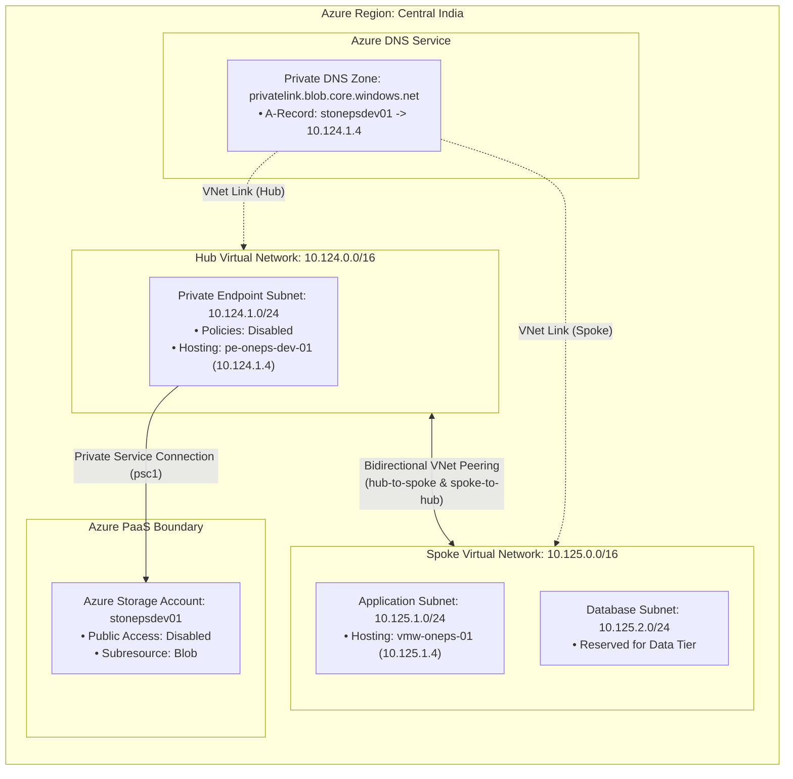

# Architecture Deep Dive: Azure Storage Private Link across Hub-and-Spoke

## Overview

This document provides an in-depth architectural breakdown of the **Hub-and-Spoke Virtual Network topology** integrated with **Azure Private Link** for Azure Storage Accounts.

---

## 🏛️ Network Topology & Micro-Segmentation



---

## 📐 Subnet Sizing & Dynamic CIDR Calculations

The environment leverages Terraform's built-in `cidrsubnet()` mathematical function within `locals.tf` to programmatically calculate non-overlapping subnet allocations from the parent virtual network's address space.

### The Calculation Formula

```hcl
address_prefixes = [
  cidrsubnet(
    local.virtual_network[value.vnet_key].address_space[0],
    value.subnet_prefix - tonumber(split("/", local.virtual_network[value.vnet_key].address_space[0])[1]),
    value.subnet_num
  )
]
```

### Breakdown of Variables

1. **Hub Network (`10.124.0.0/16`)**:
   - `base_cidr`: `10.124.0.0/16` (prefix length: 16)
   - `target_prefix`: 24
   - `prefix_extension`: `24 - 16 = 8` (divides the `/16` into $2^8 = 256$ possible `/24` subnets)
   - `subnet_num`: 1
   - **Calculated Subnet**: `10.124.1.0/24` (`subnet-oneps-dev-pe01`)

2. **Spoke Network (`10.125.0.0/16`)**:
   - `appsubnet1`: `subnet_num = 1`, `subnet_prefix = 24` $\rightarrow$ `10.125.1.0/24`
   - `dbsubnet1`: `subnet_num = 2`, `subnet_prefix = 24` $\rightarrow$ `10.125.2.0/24`

---

## 🔗 Bidirectional Virtual Network Peering

Virtual Network Peering connects the Hub and Spoke networks directly through Microsoft's private network backbone with low latency (sub-millisecond) and high throughput.

### Peering Mechanics

- Azure VNets cannot route packets to each other without explicitly established peering links.
- Peering is non-transitive by default.
- Both directions must be provisioned:
  1. `vnetpeering-oneps-dev-hub-to-spoke`: Initiated from Hub (`vnet-oneps-dev-hub01`) to Spoke (`vnet-oneps-dev-spoke01`).
  2. `vnetpeering-oneps-dev-spoke-to-hub`: Initiated from Spoke (`vnet-oneps-dev-spoke01`) to Hub (`vnet-oneps-dev-hub01`).
- Once peering status transitions to `Connected`, Azure automatically injects system routes into the default effective route tables of both networks, enabling direct IP routing between `10.125.1.0/24` and `10.124.1.0/24`.

---

## 🛡️ Dedicated Private Endpoint Subnet

Placing Private Endpoints in a dedicated subnet inside the Hub network provides several enterprise architectural advantages:

1. **Centralized Transit**: Shared services (Storage, Key Vault, Container Registry) can be accessed by multiple spoke networks without endpoint sprawl.
2. **Policy Management**: Azure historically required disabling network policies (`private_endpoint_network_policies = "Disabled"`) to provision private endpoints. Isolating endpoints prevents these settings from weakening workload subnet policies.
3. **Firewall / NVA Insertion**: A centralized hub allows future routing through Azure Firewall or an NVA via User-Defined Routes (UDRs) for deep-packet inspection if compliance mandates it.

