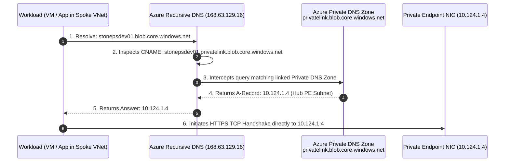

# Azure Private Link DNS Architecture & Resolution Deep Dive

## The Azure Private Link DNS Challenge

When you access an Azure Storage Account by its default public FQDN (e.g., `stonepsdev01.blob.core.windows.net`), public DNS servers resolve that hostname to Microsoft's shared public IP cluster.

When an Azure Private Endpoint is created for that storage account, Azure automatically configures a **CNAME record** in public DNS:

```
stonepsdev01.blob.core.windows.net  -->  CNAME  -->  stonepsdev01.privatelink.blob.core.windows.net
```

Without an internal Azure Private DNS Zone, the second query (`stonepsdev01.privatelink.blob.core.windows.net`) continues outward to public DNS and still resolves to the public IP.

---

## 🔄 The Resolution Chain

To achieve **Zero-Trust Private Resolution**, the architecture deploys an authoritative **Azure Private DNS Zone** named `privatelink.blob.core.windows.net` and links it to both Hub and Spoke VNets.



---

## 🎯 Private DNS Zone Groups

Rather than manually creating `A` records whenever an IP changes or an endpoint is redeployed, the `private endpoint` child module includes the `private_dns_zone_group` configuration:

```hcl
private_dns_zone_group {
  name                 = var.private_endpoint_config.private_dns_zone_group_name
  private_dns_zone_ids = var.private_endpoint_config.private_dns_zone_ids
}
```

### Key Benefits
- **Automated Lifecycle Sync**: When the Private Endpoint is created or recreated, Azure automatically creates the `A` record inside `privatelink.blob.core.windows.net`.
- **Dynamic IP Mapping**: If the NIC IP changes, the Private DNS Zone group automatically updates the record.
- **Zero Manual Drift**: Prevents configuration drift between network allocations and DNS records.

---

## 🌐 Virtual Network Links: Hub vs. Spoke

The Private DNS Zone must be linked to **every** virtual network that needs to resolve the private storage endpoint:

| Link Name | Target VNet | Auto-Registration | Function |
| :--- | :--- | :---: | :--- |
| `dns-oneps-dev-link-01` | Hub VNet (`vnet-oneps-dev-hub01`) | `true` | Enables Hub workloads and the Private Endpoint itself to resolve DNS, with VM auto-registration enabled. |
| `dns-oneps-dev-link-02` | Spoke VNet (`vnet-oneps-dev-spoke01`) | `false` | Resolution-only link. Workload VMs resolve `privatelink.blob.core.windows.net` to the private IP without polluting the zone with their own VM hostnames. |

