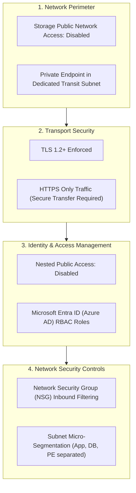

# Security Architecture & Best Practices Guide

## Zero-Trust Architecture for Azure Storage

This architecture adheres to the Microsoft Zero-Trust security model: **Explicitly verify**, **Use least-privilege access**, and **Assume breach**.

---

## 🔒 Defense-in-Depth Security Controls



---

## 🛡️ Hardening Implementation Details

### 1. Zero Public Ingress
In `environments/dev/terraform.tfvars`:
```hcl
storage_account_config = {
  "storage_account1" = {
    name_suffix                     = "01"
    rg_key                          = "rg1"
    public_network_access           = "Disabled"
    allow_nested_items_to_be_public = false
  }
}
```
- **`public_network_access = "Disabled"`**: Rejects any request arriving from outside the Private Endpoint. Even requests possessing valid storage access keys or SAS tokens are rejected with HTTP 403 Forbidden if they originate from the public internet.
- **`allow_nested_items_to_be_public = false`**: Overrides any inadvertent container-level or blob-level public anonymous read configuration.

### 2. Network Security Group (NSG) Rules
The Windows VM in `appsubnet1` is protected by a dedicated Network Security Group:
- **Inbound**: Only authorized administration traffic (RDP over TCP 3389) is permitted. In production, this can be restricted to specific management CIDRs or replaced with Azure Bastion.
- **Default Deny**: All other unsolicited inbound traffic from the internet or other VNets is blocked by Azure's default security rules.

### 3. Azure Key Vault Secrets Integration (Zero Plaintext Passwords)
To eliminate credential leakage risks in source control:
- Local administrator credentials for the Windows workload VM are stored securely in **Azure Key Vault** (`onepskv`).
- Terraform queries these secrets dynamically at plan and apply time using `data.azurerm_key_vault_secret`.
- Neither `admin_username` nor `admin_password` are stored as plain text inside `terraform.tfvars` or state files checked into git.

### 4. Transitioning from Shared Keys to Microsoft Entra ID RBAC
While Storage Account shared keys allow quick initial validation, production environments should enforce Entra ID authentication:
- Assign **Storage Blob Data Contributor** to applications, managed identities, or engineering groups.
- Set `shared_access_key_enabled = false` on the storage account resource to completely eradicate credentials exposure risks.

### 5. Encryption at Rest & In Transit
- All blob data is automatically encrypted at rest using Microsoft-managed keys (or customer-managed keys via Azure Key Vault).
- Microsoft enforces HTTPS exclusively (`enable_https_traffic_only = true` by default in AzureRM).

