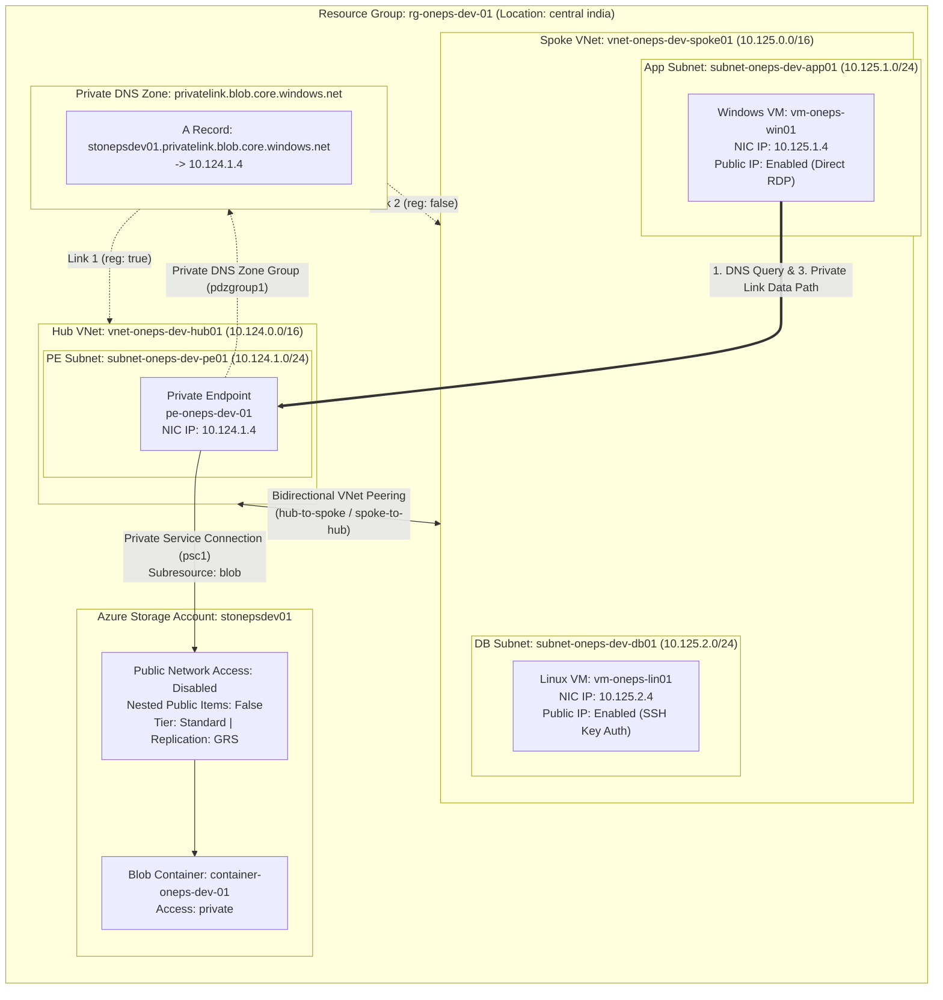

# Dev Environment: Azure Hub-Spoke Private Endpoint Architecture

## Overview

The `environments/dev` directory contains the complete root configuration for deploying the **Zero-Trust Azure Storage Private Endpoint across a Hub-and-Spoke topology**. 

This environment instantiates and orchestrates 10 child modules via Terraform's `for_each` meta-argument, using centralized naming conventions and dynamic subnet calculation.

---

## Architecture Implemented in Dev



---

## Configuration Files Breakdown

| File | Purpose | Key Contents |
| :--- | :--- | :--- |
| `version.tf` | Terraform binary and provider version constraints. | Requires Terraform `~> 1.9` and `hashicorp/azurerm ~> 5.0`. |
| `backend.tf` | Remote state backend declaration. | Contains commented `backend "azurerm" {}` for local testing or optional remote activation. |
| `backend.hcl` | Backend configuration variables. | Remote state container details (`onepsstorageforstate`, `dev.oneps.terraform.tfstate`). |
| `provider.tf` | AzureRM provider configuration. | Configures provider with default features block (`features {}`). |
| `data.tf` | External data sources for secrets. | Fetches VM credentials (`vm-username`, `vm-password`) and Linux SSH public key (`linux-vm-ssh-public-key`) conditionally from Azure Key Vault (`onepskv`). |
| `variables.tf` | Declares all environment-level input schemas. | Schema definitions including region governance validation (`allowed_locations`), Key Vault, and module maps. |
| `locals.tf` | Dynamic computations, naming standardization, and module wiring. | Prefixes, CIDR calculations using `cidrsubnet()`, Key Vault secret binding, and parameter mapping. |
| `main.tf` | Module instantiation layer. | Calls each child module using `for_each = local.*`. |
| `terraform.tfvars` | Concrete environment variable assignments. | Values targeting environment parameters, region, address spaces, and Key Vault pointers. |
| `outputs.tf` | Environment outputs. | Outputs `vm_public_ip` map showing IP addresses for deployed VMs. |

---

## How the Dev Environment Works

### 1. Centralized Resource Naming Convention (`locals.tf`)
The environment enforces consistent Azure Cloud Adoption Framework (CAF) naming patterns:

```hcl
locals {
  rg_name_prefix              = "rg-${var.project}-${var.environment}"
  storage_account_name_prefix = "st${var.project}${var.environment}"
  vnet_name_prefix            = "vnet-${var.project}-${var.environment}"
  subnet_name_prefix          = "subnet-${var.project}-${var.environment}"
  dns_zone_name_prefix        = "dns-${var.project}-${var.environment}"
  pvt_endpoint_name_prefix    = "pe-${var.project}-${var.environment}"
  vnet_peering_name_prefix    = "vnetpeering-${var.project}-${var.environment}"
  container_name_prefix       = "container-${var.project}-${var.environment}"
  vm_name_prefix              = "vm-${var.project}"
}
```

### 2. Dynamic Subnet Addressing via `cidrsubnet()`
Instead of hardcoding CIDR blocks, subnets are dynamically derived from their parent VNet's address space:

```hcl
address_prefixes = [
  cidrsubnet(
    local.virtual_network[value.vnet_key].address_space[0],
    value.subnet_prefix - tonumber(split("/", local.virtual_network[value.vnet_key].address_space[0])[1]),
    value.subnet_num
  )
]
```
For `pesubnet1`:
- Base VNet: `10.124.0.0/16`
- Calculated prefix extension: `24 - 16 = 8`
- Subnet index: `1`
- Computed CIDR: `10.124.1.0/24`

### 3. Cross-Module Dependency Resolution
`locals.tf` links module outputs as inputs to downstream modules:
- Storage Account obtains Resource Group name from `module.resource_group`.
- Subnet obtains VNet name and Resource Group name from `module.virtual_network`.
- Private Endpoint consumes Subnet ID from `module.subnet`, Storage Account ID from `module.storage_account`, and Private DNS Zone ID from `module.private_dns_zone`.
- Virtual Machines attach their NICs dynamically to specified subnets (e.g. `module.subnet[value.subnet_key].subnet_output.id`).

### 4. Zero-Plaintext Secrets Management via Azure Key Vault (`data.tf`)
To adhere to enterprise Zero-Trust security principles, sensitive credentials are no longer stored in plain text in `terraform.tfvars`.
Instead, credentials and public keys are dynamically resolved from **Azure Key Vault** at runtime using conditional queries based on each VM's `authentication_method`:

```hcl
data "azurerm_key_vault" "this" {
  name                = var.key_vault_details.key_vault_name
  resource_group_name = var.key_vault_details.resource_group_name
}

data "azurerm_key_vault_secret" "vm_username" {
  name         = var.key_vault_details.secrets.vm_username
  key_vault_id = data.azurerm_key_vault.this.id
}

data "azurerm_key_vault_secret" "vm_password" {
  count = anytrue([
    for vm in values(var.virtual_machines_config) :
    lower(vm.authentication_method) == "password"
  ]) ? 1 : 0
  name         = var.key_vault_details.secrets.vm_password
  key_vault_id = data.azurerm_key_vault.this.id
}

data "azurerm_key_vault_secret" "ssh_public_key" {
  count = anytrue([
    for vm in values(var.virtual_machines_config) :
    lower(vm.authentication_method) == "ssh_key"
  ]) ? 1 : 0
  name         = "linux-vm-ssh-public-key"
  key_vault_id = data.azurerm_key_vault.this.id
}
```

In `locals.tf`, secret values and public keys are dynamically injected into the VM configuration:
```hcl
authentication_method = value.authentication_method
admin_password        = data.azurerm_key_vault_secret.vm_password[0].value
public_key            = data.azurerm_key_vault_secret.ssh_public_key[0].value
```

#### Out-of-Band SSH Key Pair Generation & Key Vault Storage
For Linux compute nodes configured with `authentication_method = "ssh_key"`, generate an RSA 4096-bit key pair locally and store the public key inside the Azure Key Vault (`onepskv`):

```bash
# 1. Generate an RSA 4096-bit SSH key pair
ssh-keygen -t rsa -b 4096 -f ~/.ssh/azure_vm_key

# 2. Set strict file permissions on private and public keys
chmod 600 ~/.ssh/azure_vm_key
chmod 644 ~/.ssh/azure_vm_key.pub

# 3. Store the public key in Azure Key Vault as a secret
az keyvault secret set \
  --vault-name "onepskv" \
  --name "linux-vm-ssh-public-key" \
  --file ~/.ssh/azure_vm_key.pub
```

### 5. Remote State Locking with Azure Blob Storage (`backend.hcl`)
Remote state can be activated using partial configuration with `backend.hcl` to ensure concurrency lease locking and team synchronization:
```bash
terraform init -backend-config=backend.hcl
```
*(Note: The `backend "azurerm" {}` block in `backend.tf` can be toggled on or off depending on whether local state or remote state is desired).*

### 6. Region Governance & Validation Guardrail (`variables.tf`)
The environment enforces Azure regional placement guardrails via an explicit input validation rule on `var.location`:

```hcl
variable "location" {
  description = "The Azure region in which to create resources"
  type        = string
  default     = "central india"
  validation {
    condition     = contains(var.allowed_locations, var.location)
    error_message = format(
      "\u001b[33mUnsupported Azure location.\u001b[0m \nSupported locations are:\n\u001b[32m%s\u001b[0m",
      join(", ", var.allowed_locations)
    )
  }
}

variable "allowed_locations" {
  description = "List of allowed Azure regions for resource creation"
  type        = list(string)
  default     = ["south India", "central india", "west india"]
}
```

If a user specifies a region not present in `var.allowed_locations`, Terraform rejects execution during planning with a clear, colored error list of authorized regions.

---

## Deployed Resources in Dev

| Resource Type | Resource Name | Key Parameters / Values |
| :--- | :--- | :--- |
| **Resource Group** | `rg-oneps-dev-01` | Region: `central india` |
| **Hub VNet** | `vnet-oneps-dev-hub01` | Address Space: `10.124.0.0/16` |
| **PE Subnet** | `subnet-oneps-dev-pe01` | CIDR: `10.124.1.0/24`, Network Policies: `Disabled` |
| **Spoke VNet** | `vnet-oneps-dev-spoke01` | Address Space: `10.125.0.0/16` |
| **App Subnet** | `subnet-oneps-dev-app01` | CIDR: `10.125.1.0/24` |
| **DB Subnet** | `subnet-oneps-dev-db01` | CIDR: `10.125.2.0/24` |
| **VNet Peering (Hub -> Spoke)** | `vnetpeering-oneps-dev-hub-to-spoke` | Peered to `vnet-oneps-dev-spoke01` |
| **VNet Peering (Spoke -> Hub)** | `vnetpeering-oneps-dev-spoke-to-hub` | Peered to `vnet-oneps-dev-hub01` |
| **Storage Account** | `stonepsdev01` | Tier: `Standard`, Replication: `GRS`, Public Access: `Disabled` |
| **Blob Container** | `container-oneps-dev-01` | Access: `private` |
| **Private DNS Zone** | `privatelink.blob.core.windows.net` | Internal Azure Private Link zone |
| **DNS VNet Link (Hub)** | `dns-oneps-dev-link-01` | Linked to Hub VNet, `registration_enabled = true` |
| **DNS VNet Link (Spoke)** | `dns-oneps-dev-link-02` | Linked to Spoke VNet, `registration_enabled = false` |
| **Private Endpoint** | `pe-oneps-dev-01` | Target: `stonepsdev01`, Subresource: `blob`, Subnet: `subnet-oneps-dev-pe01` |
| **Windows VM** | `vm-oneps-win01` | SKU: `Standard_D2as_v5`, OS: Windows Server 2016 Datacenter, Subnet: `appsubnet1`, Public IP: Enabled, Auth: Password (via Key Vault) |
| **Linux VM** | `vm-oneps-lin01` | SKU: `Standard_D2s_v5`, OS: Ubuntu Linux 22.04 LTS, Subnet: `dbsubnet1`, Public IP: Enabled, Auth: SSH Public Key (RSA 4096-bit via Key Vault) |
| **NSGs** | `vm-oneps-win01-nsg` / `vm-oneps-lin01-nsg` | Inbound RDP (3389) on Windows, Inbound SSH (22) on Linux |

---

## Deployment & Verification Guide

### Prerequisites
1. Azure CLI authenticated (`az login`).
2. Target subscription selected (`az account set --subscription <SUBSCRIPTION_ID>`).
3. Terraform binary (`>= 1.9.0`) installed.
4. SSH key pair created and uploaded to Key Vault (`linux-vm-ssh-public-key`).

### Execution Steps

```bash
# Navigate to the dev environment
cd environments/dev

# Initialize Terraform with Azure remote state backend configuration
terraform init -backend-config=backend.hcl

# Validate configuration syntax
terraform validate

# Review proposed changes against live state
terraform plan

# Apply the infrastructure deployment
terraform apply -auto-approve
```

### Workload VM Access

#### 1. Connect to the Linux VM via Passwordless SSH
The Linux VM (`vm-oneps-lin01`) has public IP enabled with password authentication disabled:
```bash
# Retrieve public IP from Terraform output
terraform output vm_public_ip

# Connect using the private key corresponding to the public key stored in Key Vault
ssh -i ~/.ssh/azure_vm_key adminuser@<LINUX_VM_PUBLIC_IP>
```

#### 2. Connect to the Windows VM via RDP
With `public_ip_enabled = true`, connect directly to the Windows workload VM over RDP using its allocated public IP:
```bash
# Connect directly via Remote Desktop
mstsc /v:<WINDOWS_VM_PUBLIC_IP>
# Username: adminuser | Password: <configured_admin_password_from_key_vault>
```

### Verification Guide (PowerShell on Windows Workload VM)

Because this architecture deploys a Windows Server 2016 Datacenter VM (`vm-oneps-win01`), verification is executed directly inside the VM using PowerShell. Because `public_ip_enabled = true`, the VM is directly accessible over RDP via its public IP.

#### 1. Connect to the Test VM via RDP
```bash
# Retrieve public IP from Terraform output
terraform output vm_public_ip

# Connect via Remote Desktop
mstsc /v:<WINDOWS_VM_PUBLIC_IP>
# Username: adminuser | Password: <configured_admin_password>
```

#### 2. Execute Automated Verification Suite
Open PowerShell inside the Windows VM and run:
```powershell
.\scripts\verify-storage-connectivity.ps1 -StorageAccountName "stonepsdev01" -ContainerName "container-oneps-dev-01"
```

#### 3. What the PowerShell Suite Validates:
- **Test 1 - DNS Resolution**: Confirms `Resolve-DnsName` resolves `stonepsdev01.blob.core.windows.net` to the private IP `10.124.1.4` inside the Hub PE subnet, proving traffic stays off the public internet.
- **Test 2 - VNet Peering Routing**: Runs `Test-NetConnection -Port 443`, proving traffic flows smoothly from the Spoke subnet `10.125.1.0/24` across VNet peering to the Hub Private Endpoint NIC.
- **Test 3 - Private Link Ingress**: Runs `Invoke-WebRequest` verifying Azure Storage responds to the private endpoint session.

#### 4. Optional: Read/Write Test Blob via PowerShell
```powershell
$StorageKey = "<YOUR_STORAGE_ACCOUNT_KEY>"
$Ctx = New-AzStorageContext -StorageAccountName "stonepsdev01" -StorageAccountKey $StorageKey
"Private Link verified successfully from Spoke VM" | Out-File -FilePath "$env:TEMP\hello.txt"
Set-AzStorageBlobContent -File "$env:TEMP\hello.txt" -Container "container-oneps-dev-01" -Blob "hello.txt" -Context $Ctx
Get-AzStorageBlob -Container "container-oneps-dev-01" -Context $Ctx
```

