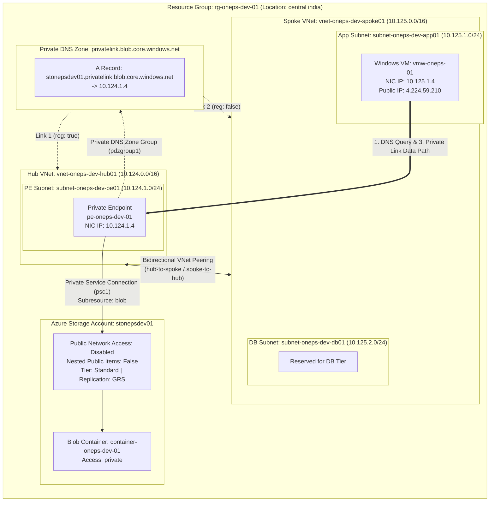

# Dev Environment: Azure Hub-Spoke Private Endpoint Architecture

## Overview

The `environments/dev` directory contains the complete root configuration for deploying the **Zero-Trust Azure Storage Private Endpoint across a Hub-and-Spoke topology**. 

This environment instantiates and orchestrates 10 child modules via Terraform's `for_each` meta-argument, using centralized naming conventions and dynamic subnet calculation.

---

## Architecture Implemented in Dev



---

## Configuration Files Breakdown

| File | Purpose | Key Contents |
| :--- | :--- | :--- |
| `version.tf` | Terraform binary and provider version constraints. | Requires Terraform `> 1.9.0` and `hashicorp/azurerm ~> 5.0`. |
| `provider.tf` | AzureRM provider configuration. | Configures provider with default features block (`features {}`). |
| `variables.tf` | Declares all environment-level input schemas. | Definitions for project, environment, region, tags, and map configs for 10 child modules. |
| `locals.tf` | Dynamic computations, naming standardization, and module wiring. | Prefixes, CIDR calculations using `cidrsubnet()`, and parameter mapping. |
| `main.tf` | Module instantiation layer. | Calls each child module using `for_each = local.*`. |
| `terraform.tfvars` | Concrete environment variable assignments. | Values targeting `central india`, `oneps`, `dev`, address spaces, and VM specifications. |
| `outputs.tf` | Environment outputs. | Outputs the Windows VM public IP for RDP access. |

---

## How the Dev Environment Works

### 1. Centralized Resource Naming Convention (`locals.tf`)
The environment enforces consistent Azure Cloud Adoption Framework (CAF) naming patterns:

```hcl
locals {
  rg_name_prefix              = "rg-${var.project}-${var.environment}"
  storage_account_name_prefix = "st${var.project}${var.environment}"
  vnet_name_prefix            = "vnet-${var.project}-${var.environment}"
  subnet_name_prefix          = "subnet-${var.project}-${var.environment}"
  dns_zone_name_prefix        = "dns-${var.project}-${var.environment}"
  pvt_endpoint_name_prefix    = "pe-${var.project}-${var.environment}"
  vnet_peering_name_prefix    = "vnetpeering-${var.project}-${var.environment}"
  container_name_prefix       = "container-${var.project}-${var.environment}"
  vm_windows_name_prefix      = "vmw-${var.project}"
}
```

### 2. Dynamic Subnet Addressing via `cidrsubnet()`
Instead of hardcoding CIDR blocks, subnets are dynamically derived from their parent VNet's address space:

```hcl
address_prefixes = [
  cidrsubnet(
    local.virtual_network[value.vnet_key].address_space[0],
    value.subnet_prefix - tonumber(split("/", local.virtual_network[value.vnet_key].address_space[0])[1]),
    value.subnet_num
  )
]
```
For `pesubnet1`:
- Base VNet: `10.124.0.0/16`
- Calculated prefix extension: `24 - 16 = 8`
- Subnet index: `1`
- Computed CIDR: `10.124.1.0/24`

### 3. Cross-Module Dependency Resolution
`locals.tf` links module outputs as inputs to downstream modules:
- Storage Account obtains Resource Group name from `module.resource_group`.
- Subnet obtains VNet name and Resource Group name from `module.virtual_network`.
- Private Endpoint consumes Subnet ID from `module.subnet`, Storage Account ID from `module.storage_account`, and Private DNS Zone ID from `module.private_dns_zone`.
- Windows VM attaches its NIC to `module.subnet["appsubnet1"].subnet_output.id`.

---

## Deployed Resources in Dev

| Resource Type | Resource Name | Key Parameters / Values |
| :--- | :--- | :--- |
| **Resource Group** | `rg-oneps-dev-01` | Region: `central india` |
| **Hub VNet** | `vnet-oneps-dev-hub01` | Address Space: `10.124.0.0/16` |
| **PE Subnet** | `subnet-oneps-dev-pe01` | CIDR: `10.124.1.0/24`, Network Policies: `Disabled` |
| **Spoke VNet** | `vnet-oneps-dev-spoke01` | Address Space: `10.125.0.0/16` |
| **App Subnet** | `subnet-oneps-dev-app01` | CIDR: `10.125.1.0/24` |
| **DB Subnet** | `subnet-oneps-dev-db01` | CIDR: `10.125.2.0/24` |
| **VNet Peering (Hub -> Spoke)** | `vnetpeering-oneps-dev-hub-to-spoke` | Peered to `vnet-oneps-dev-spoke01` |
| **VNet Peering (Spoke -> Hub)** | `vnetpeering-oneps-dev-spoke-to-hub` | Peered to `vnet-oneps-dev-hub01` |
| **Storage Account** | `stonepsdev01` | Tier: `Standard`, Replication: `GRS`, Public Access: `Disabled` |
| **Blob Container** | `container-oneps-dev-01` | Access: `private` |
| **Private DNS Zone** | `privatelink.blob.core.windows.net` | Internal Azure Private Link zone |
| **DNS VNet Link (Hub)** | `dns-oneps-dev-link-01` | Linked to Hub VNet, `registration_enabled = true` |
| **DNS VNet Link (Spoke)** | `dns-oneps-dev-link-02` | Linked to Spoke VNet, `registration_enabled = false` |
| **Private Endpoint** | `pe-oneps-dev-01` | Target: `stonepsdev01`, Subresource: `blob`, Subnet: `subnet-oneps-dev-pe01` |
| **Windows VM** | `vmw-oneps-01` | SKU: `Standard_D4_v5`, OS: Windows Server 2016 Datacenter |
| **Public IP** | `vmw-oneps-01-public-ip` | Static Public IP (e.g., `4.224.59.210`) |
| **NSG** | `vmw-oneps-01-nsg` | Inbound TCP 3389 (RDP) allowed |

---

## Deployment & Verification Guide

### Prerequisites
1. Azure CLI authenticated (`az login`).
2. Target subscription selected (`az account set --subscription <SUBSCRIPTION_ID>`).
3. Terraform binary (`>= 1.9.0`) installed.

### Execution Steps

```bash
# Navigate to the dev environment
cd environments/dev

# Initialize Terraform providers and child modules
terraform init

# Validate configuration syntax
terraform validate

# Review proposed changes against live state
terraform plan

# Apply the infrastructure deployment
terraform apply -auto-approve
```

### Verification Guide (Bash)

Execute verification directly using the provided automated script or manual Bash utilities:

#### 1. Automated Script Execution
```bash
chmod +x ../../scripts/verify-storage-connectivity.sh
../../scripts/verify-storage-connectivity.sh stonepsdev01 10.124.
```

#### 2. Manual Verification Commands (Bash)
```bash
# 1. Test DNS Resolution
nslookup stonepsdev01.blob.core.windows.net
# Returns: stonepsdev01.privatelink.blob.core.windows.net -> 10.124.1.4

# 2. Test TCP Port 443 Handshake to Private Endpoint
nc -z -v -w 5 stonepsdev01.blob.core.windows.net 443
# Returns: Connection to stonepsdev01.blob.core.windows.net 443 port [tcp/https] succeeded!

# 3. Test HTTPS Endpoint Reachability
curl -I https://stonepsdev01.blob.core.windows.net/
# Returns: HTTP/1.1 400 Bad Request or 403 Forbidden (verifying Private Link TLS connection)

# 4. Azure CLI Blob Verification (Private Ingress)
az storage blob upload \
  --account-name stonepsdev01 \
  --container-name container-oneps-dev-01 \
  --name "test-file.txt" \
  --data "Private Link Zero-Trust Data Access Verified" \
  --auth-mode login
```

