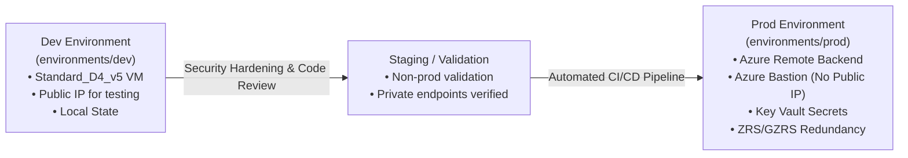

# Production Environment: Deployment & Hardening Guide

## Overview

The `environments/prod` directory is designated for the **Production deployment** of the Azure Hub-and-Spoke Storage Private Endpoint infrastructure.

This guide details the architectural promotion strategy, security hardening, and enterprise best practices required when deploying to a production Azure subscription.

---

## Promotion Workflow: From Dev to Prod



---

## Production Architectural Recommendations & Hardening

| Area | Dev Implementation | Production Recommended Pattern | Rationale |
| :--- | :--- | :--- | :--- |
| **State Storage** | Local state (`terraform.tfstate`) | **Azure Remote Backend** (`azurerm` backend with Blob lease locking) | Prevents concurrent state corruption, enables team collaboration, and encrypts state at rest. |
| **VM Ingress** | Static Public IP with RDP (Port 3389) | **Azure Bastion** or **P2S/S2S VPN** (`public_ip_enabled = false`) | Eliminates public internet attack surfaces; adheres to Microsoft Zero-Trust principles. |
| **Secrets Management** | Passwords in `terraform.tfvars` | **Azure Key Vault** / `azurerm_key_vault_secret` | Eliminates hardcoded plain-text credentials in repository version control. |
| **Storage Redundancy** | Geo-Redundant (`GRS`) | **Zone-Redundant / Geo-Zone-Redundant** (`ZRS` or `GZRS`) | Protects against datacenter facility outages within an Azure availability zone. |
| **Access Control** | Storage Account Keys / SAS | **Microsoft Entra ID (Azure AD) RBAC** + Storage Access Keys Disabled | Implements fine-grained role assignments (e.g., *Storage Blob Data Contributor*) without shared keys. |
| **Observability** | Standard Azure metrics | **Azure Monitor Diagnostic Settings** to Log Analytics | Ingests storage read/write logs, latency metrics, and private DNS audit trails for compliance. |

---

## Step-by-Step Production Configuration

### 1. Remote State Backend (`version.tf`)
Create `environments/prod/version.tf` with remote state configuration:

```hcl
terraform {
  required_version = ">1.9.0"
  required_providers {
    azurerm = {
      source  = "hashicorp/azurerm"
      version = "~>5.0"
    }
  }

  backend "azurerm" {
    resource_group_name  = "rg-oneps-terraform-state"
    storage_account_name = "stonenpsterraformstate"
    container_name       = "tfstate"
    key                  = "prod.hub-spoke-private-endpoint.tfstate"
    use_azuread_auth     = true
  }
}
```

### 2. Parameter Tuning for Production (`terraform.tfvars`)
Set production-grade configurations:

```hcl
environment = "prod"
project     = "oneps"
location    = "central india"

tags = {
  environment = "prod"
  managedby   = "terraform"
  cost_center = "cc-infrastructure-001"
  sla         = "mission-critical"
}

# Enforce zero public IP on compute nodes
virtual_machine_windows_config = {
  "vm1" = {
    vm_name_suffix    = "01"
    vm_size           = "Standard_D4_v5"
    admin_username    = "azureadmin"
    admin_password    = var.vault_admin_password # Retrieved dynamically from Key Vault
    rg_key            = "rg1"
    subnet_key        = "appsubnet1"
    public_ip_enabled = false # Disables public IP
    nsg_rules         = {}
  }
}
```

---

## Automated Production Deployment Pipeline

Deployments to production should follow an automated CI/CD pipeline using GitHub Actions with OpenID Connect (OIDC):

```bash
# Production deployment via GitHub Actions or authorized CLI runner
cd environments/prod
terraform init
terraform plan -out=prod.tfplan
terraform apply prod.tfplan
```
