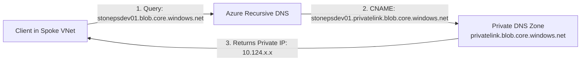

# Azure Private DNS Zone Terraform Child Module

## Overview

The `private dns zone` child module provisions an [Azure Private DNS Zone](https://learn.microsoft.com/en-us/azure/dns/private-dns-overview) (`azurerm_private_dns_zone`). It provides authoritative domain name resolution within Azure Virtual Networks without exposing DNS queries to the public Internet.

---

## Features

- **Private Link Name Resolution**: Supports canonical Microsoft Private Link zone namespaces, such as `privatelink.blob.core.windows.net`.
- **Seamless ARM Integration**: Attaches to the designated resource group and provides outputs for VNet Links and Private Endpoint DNS Zone Groups.
- **Resource Export**: Returns the complete `azurerm_private_dns_zone` object (ID, name, max/number of record sets).

---

## Architecture Role

In this architecture:
- **Zone Name**: `privatelink.blob.core.windows.net`
- **Function**:
  1. Integrates with the Private Endpoint's `private_dns_zone_group` to automatically register an `A` record mapping the storage account FQDN (`stonepsdev01.privatelink.blob.core.windows.net`) to the private IP (`10.124.1.4` / `10.124.2.4`) in the Hub PE subnet.
  2. Resolves DNS requests issued by clients within linked virtual networks (both Hub and Spoke).



---

## Inputs

| Name | Description | Type | Required | Default |
| :--- | :--- | :--- | :---: | :---: |
| `dns_zone_config` | Configuration object defining the Private DNS Zone parameters. | <pre>object({<br>  name                = string<br>  resource_group_name = string<br>})</pre> | **Yes** | N/A |

### Input Object Attributes

- `name` (`string`): The domain name of the private DNS zone (e.g., `privatelink.blob.core.windows.net`).
- `resource_group_name` (`string`): Name of the parent resource group.

---

## Outputs

| Name | Description | Type | Sensitive |
| :--- | :--- | :--- | :---: |
| `private_dns_zone_output` | Complete `azurerm_private_dns_zone` resource object with `id`, `name`, etc. | `object` | No |

---

## Usage Example

```hcl
module "private_dns_zone" {
  source = "../../modules/private dns zone"

  dns_zone_config = {
    name                = "privatelink.blob.core.windows.net"
    resource_group_name = "rg-oneps-dev-01"
  }
}

# Consuming the DNS Zone ID for VNet Linking
output "dns_zone_id" {
  value = module.private_dns_zone.private_dns_zone_output.id
}
```
