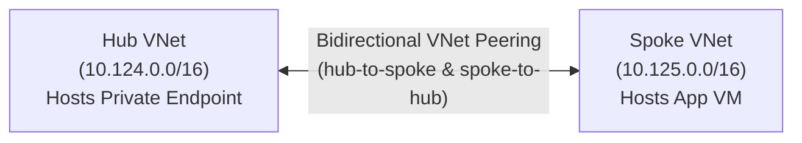

# Azure Virtual Network Peering Terraform Child Module

## Overview

The `virtual network peering` child module provisions an [Azure Virtual Network Peering](https://learn.microsoft.com/en-us/azure/virtual-network/virtual-network-peering-overview) (`azurerm_virtual_network_peering`). It bridges two virtual networks with low-latency, high-bandwidth interconnects using Microsoft's private network backbone.

---

## Features

- **Directional Interconnect**: Provisions one direction of a VNet peering link. Note that Azure peering requires bidirectional setup (A -> B and B -> A) for full two-way communication.
- **Backbone Routing**: Traffic between peered networks never leaves Microsoft's private network infrastructure and never traverses the public Internet.
- **Resource Independence**: Connects networks cleanly using resource group names, source VNet names, and target VNet resource IDs.

---

## Architecture Role

In this Hub-and-Spoke topology, bidirectional peering is established between the Hub VNet and Spoke VNet:



1. **`hub-to-spoke` (`vnetpeering-oneps-dev-hub-to-spoke`)**:
   - Source VNet: `vnet-oneps-dev-hub01`
   - Remote VNet ID: Resource ID of `vnet-oneps-dev-spoke01`
2. **`spoke-to-hub` (`vnetpeering-oneps-dev-spoke-to-hub`)**:
   - Source VNet: `vnet-oneps-dev-spoke01`
   - Remote VNet ID: Resource ID of `vnet-oneps-dev-hub01`

This peering enables the Windows VM in the Spoke VNet to reach the Private Endpoint IP in the Hub VNet directly at the network layer.

---

## Inputs

| Name | Description | Type | Required | Default |
| :--- | :--- | :--- | :---: | :---: |
| `vnet_peering_config` | Configuration object defining the VNet peering parameters. | <pre>object({<br>  name                      = string<br>  resource_group_name       = string<br>  virtual_network_name      = string<br>  remote_virtual_network_id = string<br>})</pre> | **Yes** | N/A |

### Input Object Attributes

- `name` (`string`): Name of the peering connection (e.g., `vnetpeering-oneps-dev-hub-to-spoke`).
- `resource_group_name` (`string`): Resource group where the source virtual network resides.
- `virtual_network_name` (`string`): Name of the source virtual network initiating the peering link.
- `remote_virtual_network_id` (`string`): Full ARM Resource ID of the destination/target virtual network.

---

## Outputs

*(This module currently does not export outputs directly, as peering connections are terminating relationship resources. In future releases, `peering_id` and `peering_state` can be surfaced.)*

---

## Usage Example

```hcl
# Hub to Spoke Peering
module "hub_to_spoke" {
  source = "../../modules/virtual network peering"

  vnet_peering_config = {
    name                      = "vnetpeering-oneps-dev-hub-to-spoke"
    resource_group_name       = "rg-oneps-dev-01"
    virtual_network_name      = "vnet-oneps-dev-hub01"
    remote_virtual_network_id = "/subscriptions/.../resourceGroups/rg-oneps-dev-01/providers/Microsoft.Network/virtualNetworks/vnet-oneps-dev-spoke01"
  }
}

# Spoke to Hub Peering
module "spoke_to_hub" {
  source = "../../modules/virtual network peering"

  vnet_peering_config = {
    name                      = "vnetpeering-oneps-dev-spoke-to-hub"
    resource_group_name       = "rg-oneps-dev-01"
    virtual_network_name      = "vnet-oneps-dev-spoke01"
    remote_virtual_network_id = "/subscriptions/.../resourceGroups/rg-oneps-dev-01/providers/Microsoft.Network/virtualNetworks/vnet-oneps-dev-hub01"
  }
}
```
